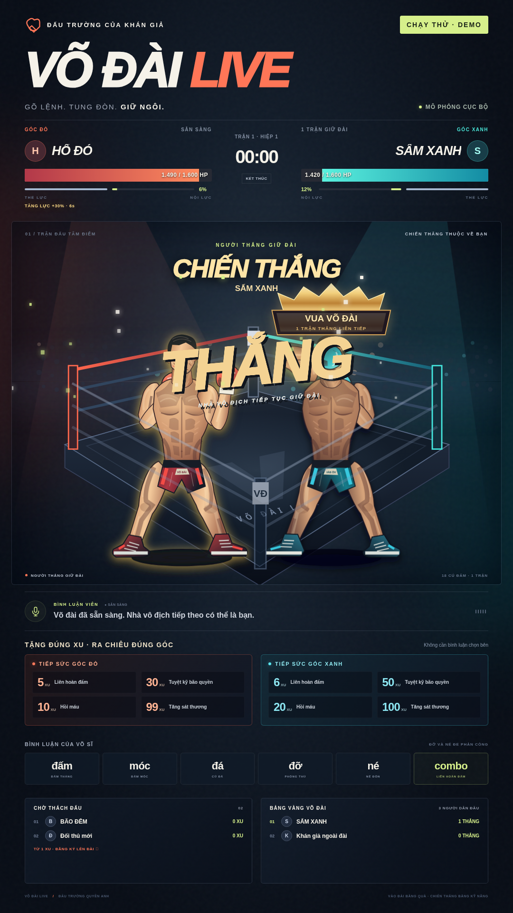

# VÕ ĐÀI LIVE 1.1 · Đấu trường quyền anh

Game boxing arcade tương tác cho TikTok LIVE, kèm bảng điều khiển tiếng Việt và overlay dọc cho OBS/TikTok LIVE Studio. Hai người xem lên đài; bình luận để ra đòn, khán giả tặng đúng mức xu để tiếp sức trực tiếp cho góc đỏ hoặc xanh. Bản 1.1 có võ sĩ minh họa 2D theo tỷ lệ cơ thể người, chuỗi liên hoàn/tuyệt kỹ nhiều bước, danh hiệu trên đầu nhà vô địch và luật nhiều hiệp chỉ kết thúc khi phân thắng bại. Đây là đồ họa SVG hoạt họa, không phải người thật hoặc mô hình 3D quang thực.

**Không có key bản quyền, kích hoạt máy hoặc máy chủ cấp phép.** Mã điều khiển nội bộ được tự tạo để bảo vệ thao tác trên máy, không phải giấy phép. TikTok và Microsoft TTS vẫn là dịch vụ bên ngoài; kết nối thật phụ thuộc trạng thái LIVE, mạng và giới hạn nhà cung cấp.

## Giao diện bản 1.1



[Ảnh bảng điều khiển và quy tắc xu](docs/images/control-1.1.png) · [Kết quả kiểm thử](docs/KIEM-THU.md)

## Chạy nhanh

Cần **Node.js ≥22**; khuyến nghị Node.js 24.x. Mở terminal trong thư mục dự án:

```sh
npm ci --omit=dev --ignore-scripts
npm start
```

Mở `http://localhost:3100/`. Overlay: `http://localhost:3100/overlay.html`. Nếu cổng bận, ứng dụng thử tối đa 20 cổng; dùng địa chỉ thực tế ghi trong terminal/bảng Kết nối.

Trên Windows: giải nén ra thư mục có quyền ghi, mở `CHAY.bat`. Bản Windows portable có `node.exe` và dependencies nên không cần cài Node riêng. Giữ cửa sổ chạy mở trong suốt buổi LIVE; đóng bằng Ctrl+C để lưu dữ liệu.

## Thử trước khi lên sóng

1. Mở bảng điều khiển, bật chế độ **DEMO** và chạy demo tự động.
2. Mở overlay riêng; chạm nút bật âm thanh. Preview được tắt tiếng để tránh phát hai lần.
3. Quan sát HP, thể lực, năng lượng, combo, KO và người thắng giữ đài.
4. Dùng công cụ mô phỏng để thử người tặng/đòn cụ thể. Mô phỏng chỉ chạy ở DEMO.
5. Dừng demo và chuyển về **LIVE** trước khi kết nối kênh thật. Hàng chờ, xu và bảng xếp hạng demo không được cộng vào LIVE.

Kiểm thử hoàn toàn ngoại tuyến:

```sh
ARENA_OFFLINE=1 npm start
```

PowerShell:

```powershell
$env:ARENA_OFFLINE = '1'
npm start
```

Chế độ này không kết nối TikTok hay tạo giọng Microsoft qua mạng. Chữ MC và hiệu ứng vẫn dùng được. Dự phòng chỉ phát khi có giọng tiếng Việt trên máy; nếu không có, overlay giữ phụ đề và báo rõ, không tự chọn giọng Anh. Xóa biến này khi cần kết nối LIVE thật.

## Tặng đúng xu để hỗ trợ đúng góc

Khi đủ hai võ sĩ, **mọi người xem đều có thể tiếp sức bằng đúng tổng xu của một lượt quà**, không cần lên đài hoặc bình luận chọn bên trước. Bảng mặc định:

| Tác dụng | Góc đỏ | Góc xanh |
|---|---:|---:|
| Liên hoàn đấm | 5 xu | 6 xu |
| Tuyệt kỹ bão quyền | 30 xu | 50 xu |
| Hồi máu có giới hạn | 10 xu | 20 xu |
| Tăng sát thương ×1,3 trong 12 giây | 99 xu | 100 xu |

Bảng này được ưu tiên hơn người tặng đang đứng góc nào, góc đã bình luận và mapping ID quà. Ví dụ võ sĩ đỏ tặng 6 xu vẫn hỗ trợ góc xanh. Vào **Quà & luật → Mức xu dành riêng cho hai góc** để sửa; mỗi mức xu chỉ được gán một góc/một tác dụng. Dùng các nút **Khách ngoài đài** trong Phòng thử để thử đúng luồng khán giả.

Mức xu là tổng của một lượt quà đã chốt, không phải tổng xu tích lũy cả buổi. Quà chuỗi chốt muộn sau timeout chỉ bổ sung thống kê; không kích hoạt thêm một đòn hoặc chuyển nhầm góc. Quà không khớp bảng vẫn dùng luật quà thông thường/hàng chờ; xem hướng dẫn để biết thứ tự.

## Trận nhiều hiệp, không có hòa

Mặc định 1.600 HP, mỗi hiệp 120 giây, nghỉ 8 giây. Hết hiệp không tính thắng thua bằng điểm. Bình thường một bên về 0 HP mới kết thúc; trọng tài có thể chỉ định rõ đỏ hoặc xanh thắng, không có lựa chọn hòa. Võ sĩ có nhịp đấm tự động nhẹ để trận không đứng yên, còn bình luận, thể lực, phòng thủ và quà thay đổi diễn biến.

Người ít máu có một cơ hội giáp phản công; hồi máu bị giới hạn theo thời gian. Từ hiệp 3 áp lực tăng, hồi máu giảm; từ hiệp 5 ngừng hồi máu để tránh bế tắc. Người thắng giữ đúng góc cũ, mang danh hiệu lớn và chuỗi thắng sang người thách đấu tiếp theo.

## Lệnh người xem

| Bình luận | Tác dụng |
|---|---|
| `lên đài` | Vào hàng chờ nếu đã đủ điều kiện xu; miễn phí khi phí vào đài = 0 |
| `đỏ` / `xanh` | Chọn góc cho quà không khớp bảng xu riêng; bảng xu riêng luôn được ưu tiên |
| `đấm` / `jab` | Đấm thẳng |
| `móc` / `đấm móc` | Đấm móc |
| `đấm bốc` / `uppercut` | Móc ngược |
| `đá` / `kick` | Đá vòng theo phong cách arcade |
| `đỡ` / `chặn` / `block` | Đỡ đòn kế tiếp |
| `né` / `dodge` | Né trong thời gian ngắn |
| `liên hoàn` / `combo` | Combo tốn nhiều thể lực |
| `bão quyền` / `ultimate` | Tuyệt kỹ, cần đủ 100 năng lượng |

Chỉ hai võ sĩ đang thi đấu được ra đòn bằng comment. Có hồi đòn và thể lực để chống spam. Người ngoài đài tặng đúng bảng xu sẽ hỗ trợ trực tiếp khi đủ hai võ sĩ; khi chưa đủ người hoặc quà không khớp/chưa chọn góc, quà có thể dùng để vào hàng chờ. Xem [hướng dẫn đầy đủ](docs/HUONG-DAN.md) để biết điểm xu, hàng chờ và vận hành buổi LIVE.

## OBS / LIVE Studio

- Thêm nguồn Browser/Link, dán link overlay của ứng dụng.
- Đặt **1080 × 1920**. Trong OBS bật **Control audio via OBS** nếu muốn quản lý tiếng tại mixer.
- Nền trong suốt: thêm `?bg=transparent` vào link.
- Overlay chỉ xem, không điều khiển trận. Bảng điều khiển chỉ hoạt động trên máy chạy server.
- Điện thoại cùng Wi-Fi: bật chế độ điện thoại ở bảng Kết nối; cho phép cổng thực tế qua firewall trên mạng riêng. Không cần mở port router ra Internet.

## Kiểm tra và đóng gói

```sh
npm test
npm run check
npm run package
```

Gói nguồn được tạo trong `dist/VoDaiLive-1.1.0-Source.zip`. Để tạo bản Windows portable có dependencies và runtime:

```sh
npm run package -- --runtime /duong/dan/node.exe
```

Kết quả `dist/VoDaiLive-1.1.0-Windows-Portable.zip` và tệp SHA-256. Truyền runtime Node Windows x64 ≥22 từ nguồn tin cậy. Script không tải hoặc xác minh nhà phát hành runtime thay bạn; không dùng executable không rõ nguồn.

Gói phát hành không kèm `data/`, nhạc cá nhân hay hồ sơ trình duyệt. Nâng từ 1.0 giữ lại cài đặt đã lưu; bấm **Áp dụng luật đề xuất** trong Quà & luật nếu muốn dùng bộ thông số mới cho trận tiếp theo. Khi cập nhật thủ công, tắt ứng dụng, sao lưu và giữ **`data/` + `nhac/`**, thay mã chương trình, cài dependencies theo lockfile nếu cần rồi chạy lại. Không có updater gắn máy chủ thương mại của bản mẫu.

## Tài liệu

- [Hướng dẫn vận hành, luật chơi và xử lý lỗi](docs/HUONG-DAN.md)
- [Kiến trúc, dữ liệu và API tích hợp](docs/KIEN-TRUC.md)
- [Nguồn tham khảo và thư viện bên thứ ba](THIRD_PARTY_NOTICES.md)
- [Kết quả kiểm thử và phạm vi đã xác minh](docs/KIEM-THU.md)

Kiến trúc được xây theo cách chia tầng của bộ Thắp Sáng Bản Đồ người dùng cung cấp, với luật boxing và giao diện riêng. Không mang theo key, profile Edge hoặc lịch sử người xem của bộ mẫu. Kiểm thử mô phỏng không thay thế việc thử TikTok, Windows, OBS và điện thoại thật trước một buổi phát sóng.
